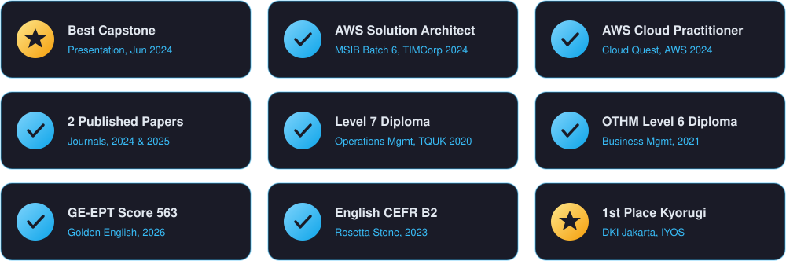

  

# 👋 Hi, I'm Farel Bayone Meijabar

### Information Technology Graduate | Application Development | API Engineering | AI & Cloud Computing

  

I'm an **Information Technology graduate** with a strong interest in application development, backend engineering, API integration, artificial intelligence, and cloud computing.

My journey in technology revolves around understanding how systems work, building practical digital solutions, and exploring technologies that make applications more efficient, scalable, and reliable.

Through academic projects, technical training, and professional experience, I have developed an understanding of software development processes, RESTful API integration, database management, application testing, and cloud-based solutions.

Currently, I am expanding my professional experience in **IT Application Development at PT Bank Rakyat Indonesia (Persero) Tbk**, where I gain exposure to enterprise application environments, Open API Gateway management, API development, testing, and documentation.

I believe that technology is not just about writing code. It is about solving problems, connecting systems, and creating meaningful solutions.

  

## 🧑‍💻 About Me

- 🎓 **Education:** Bachelor's Degree in Information Technology.
- 🏢 **Current Experience:** IT Application Development Intern at PT Bank Rakyat Indonesia (Persero) Tbk.
- 🔌 **Technical Interest:** API Development, API Gateway, Backend Engineering, and System Integration.
- 🤖 **AI Exploration:** Generative AI, AI Chatbots, and AI-powered Applications.
- ☁️ **Cloud Interest:** AWS Cloud Computing and Cloud Architecture.
- 🛠️ **Development Focus:** Building functional, maintainable, and user-oriented applications.
- 📚 **Learning Philosophy:** Continuous learning, experimentation, and practical implementation.

**My technical interests include:**

`Application Development` · `API Engineering` · `Backend Development` · `System Integration` · `Artificial Intelligence` · `Cloud Computing`

  

  

## 💼 Professional Experience

### IT Application Development Intern

**PT Bank Rakyat Indonesia (Persero) Tbk (BRI)**

`2026 – 2027` | Indonesia

Working within an enterprise IT environment, gaining practical experience in application development, API management, and integration processes.

**Key Responsibilities & Technical Exposure**

- Participating in Open API Gateway management and API lifecycle activities.
- Reviewing API transaction histories to identify active and inactive APIs based on usage patterns.
- Developing, testing, and validating RESTful APIs using API development tools.
- Exploring API orchestration and integration using IBM webMethods.
- Utilizing Postman for API testing, request validation, and response analysis.
- Working with Software AG Designer for API development and configuration.
- Maintaining technical documentation and knowledge management using Confluence.
- Exploring collaborative development workflows using Git and Bitbucket.
- Gaining exposure to enterprise application development practices and technical troubleshooting.

**Technologies & Tools**

`IBM webMethods` `Software AG Designer` `Postman` `Confluence` `Bitbucket` `Git`

  

## 🚀 Featured Projects

A collection of academic, personal, and experimental projects that represent my journey in application development, artificial intelligence, and software engineering.

### 🌱 Urban Seeds – Urban Farming Chatbot

**Generative AI | Conversational AI | Cloud Computing**

An AI-powered chatbot designed to provide information and assistance related to urban farming, helping users explore sustainable agriculture through conversational interactions.

**Key Features**
- AI-powered conversational assistance.
- Urban farming information and knowledge support.
- Integration with generative AI services.
- Interactive user interface.

**Tech Stack:** `Python` `Flask` `Streamlit` `Amazon Bedrock`

🏆 **Achievement:** Best Capstone Presentation – 2024.

  

### 🪴 Planti AI – Intelligent Plant Care Assistant

**Artificial Intelligence | Image Recognition | Application Development**

An AI-powered plant care assistant designed to help users identify plant conditions and obtain recommendations through image-based analysis.

**Key Features**
- Image-based plant identification and disease analysis.
- AI-powered plant care recommendations.
- Interactive application interface.
- Data management using a relational database.

**Tech Stack:** `Python` `Streamlit` `Google Gemini API` `SQLite`

  

### 💤 SleepWise – Sleep Disorder Expert System

**Expert System | Web Development | Decision Support System**

A web-based expert system developed to assist users in identifying potential sleep disorders through symptom-based diagnosis.

The system implements Forward Chaining and Certainty Factor methods to process user responses and calculate diagnostic confidence levels.

**Key Features**
- Interactive symptom-based consultation.
- Forward Chaining inference mechanism.
- Certainty Factor calculation.
- Diagnostic result with confidence percentage.
- User and administrator functionality.
- Database management for symptoms, knowledge bases, and diagnosis history.

**Tech Stack:** `PHP` `MySQL` `JavaScript` `HTML` `CSS`

**Development Methodology:** Waterfall SDLC and Black Box Testing.

  

## 🧰 Technical Skills & Technologies

Technologies and tools I have explored through professional experience, academic projects, technical training, and independent learning.

  

### Programming Languages

  
  
  
  
  
  
  

### Frameworks & Development

  
  
  

### API Development & Integration

  
  
  

- RESTful API Development
- API Testing & Validation
- API Gateway Management
- API Integration & Orchestration
- Request & Response Handling
- API Documentation

### Database Management

  
  

### Artificial Intelligence & Cloud Computing

  
  
  

- AWS Cloud Architecture Fundamentals
- Amazon EC2
- Amazon Bedrock
- Generative AI Integration
- AI Chatbot Development
- Image-Based AI Applications

### DevOps, Monitoring & Collaboration

  
  
  
  
  
  
  
  

Additional exposure: `Kibana` `Rancher`

  

## 🎓 Education

### Bachelor of Information Technology

**Institut Teknologi dan Bisnis Ahmad Dahlan Jakarta**

`2021 – 2025`

- Faculty: Engineering and Design.
- Degree: Bachelor of Information Technology.
- GPA: **3.54 / 4.00**

**Academic Focus**
- Software Engineering
- Web Application Development
- Database Management Systems
- Artificial Intelligence
- Information Systems Analysis and Design
- Cloud Computing Fundamentals

**Final Year Project / Undergraduate Thesis**

*Expert System for Diagnosing Sleep Disorders Using Forward Chaining and Certainty Factor Methods.*

Developed a web-based expert system using PHP and MySQL to assist in identifying sleep disorders through a knowledge-based inference mechanism and certainty-level calculations.

  

## 🏆 Achievements & Professional Development

- 🥇 **Best Capstone Presentation (June 2024)** – Urban Seeds Farming Chatbot, AWS Cloud Professional program, MSIB Batch 6.
- ☁️ **AWS Cloud Solution Architect** – Kampus Merdeka MSIB Batch 6, TIMCorp Academy (16 Feb – 30 Jun 2024).
- ☁️ **AWS Cloud Quest: Cloud Practitioner** – Amazon Web Services (2024).
- 📄 **2 Published Journal Papers** – Jurnal Ilmu Komputer dan Matematika, Vol. 5 No. 2 (2024), and Sasambo: Jurnal Abdimas, Vol. 7 No. 2 (2025, first author).
- 🎓 **Level 7 Diploma in Operations Management** – TQUK, Inspire London College (2020).
- 🎓 **OTHM Level 6 Diploma in Business Management** – Ascent School of Management London (2021).
- 🗣️ **GE-EPT Score: 563** – Golden English (2026).
- 🗣️ **English CEFR Level B2** – Rosetta Stone (2023).
- 🥋 **1st Place – Kyorugi DKI Jakarta**, IYOS.
- 💻 Participated in technical workshops and professional development programs.

  

  

## 🌐 Areas of Interest

I am continuously exploring different areas of technology to strengthen my technical foundation and broaden my professional capabilities.

| Domain | Interests |
|---|---|
| Application Development | Web Applications, Full-Stack Development |
| Backend Engineering | Server-Side Development, Business Logic |
| API Engineering | REST APIs, API Gateway, Integration |
| Artificial Intelligence | Generative AI, AI Chatbots |
| Cloud Computing | AWS, Cloud Architecture |
| Software Engineering | System Design, Testing, Documentation |
| DevOps | CI/CD, Version Control, Monitoring |

  

## 📈 GitHub Statistics

  
  

  

  

  

  <picture>
    <source media="(prefers-color-scheme: dark)" srcset="https://raw.githubusercontent.com/farelbayone/farelbayone/output-arcade/pacman-contribution-graph-dark.svg">
    <source media="(prefers-color-scheme: light)" srcset="https://raw.githubusercontent.com/farelbayone/farelbayone/output-arcade/pacman-contribution-graph.svg">
    
  </picture>

  

## 🎯 Currently Exploring

- Strengthening backend development and application architecture skills.
- Deepening knowledge of Open API Gateway and enterprise API integration.
- Exploring IBM webMethods and API orchestration.
- Building practical full-stack web applications.
- Experimenting with Generative AI and AI-powered systems.
- Expanding knowledge of AWS and cloud-based architectures.
- Improving software engineering practices and development workflows.

  

## 🤝 Let's Connect!

I'm always open to connecting with developers, technology enthusiasts, and professionals who share similar interests in software engineering, API development, artificial intelligence, and cloud computing.

  
  
  

  

  <i>"Great things are built through curiosity, consistency, and continuous improvement."</i>
    
  <strong>Thanks for visiting my GitHub profile!</strong> 🚀

  

  

